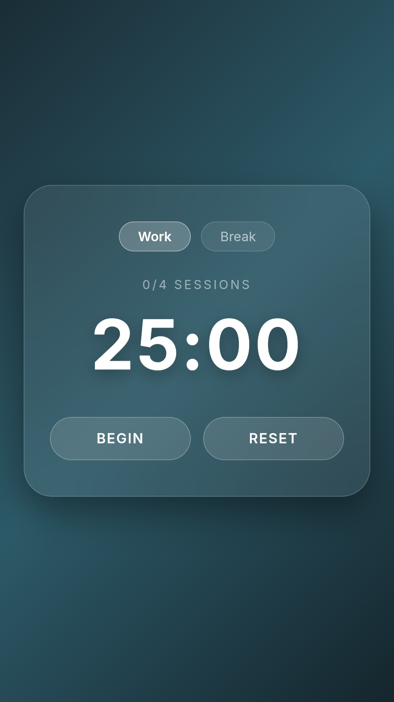
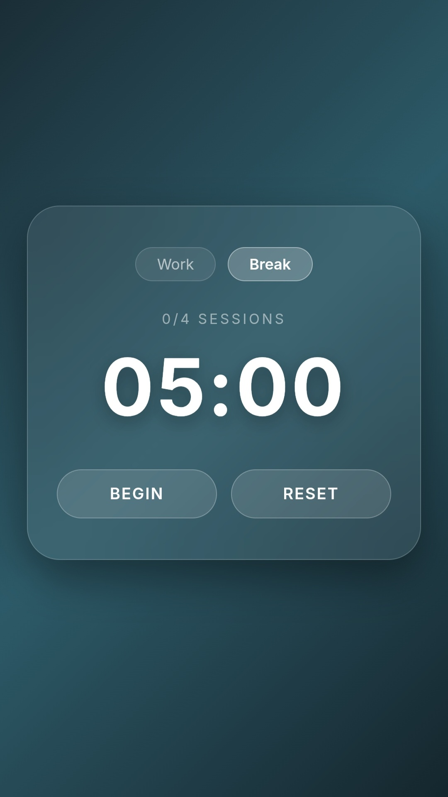

# Pomodoro Timer: Glassmorphism Edition

Sebuah aplikasi web *Pomodoro timer* sederhana namun estetik, dibuat sepenuhnya menggunakan perangkat *mobile* sebagai bagian dari eksperimen *coding* personal. Didesain dengan prinsip UI Glassmorphism modern untuk membantu menjaga fokus sesi kerja Anda.

Sebuah aplikasi web *Pomodoro timer* sederhana namun estetik, dibuat sepenuhnya menggunakan perangkat *mobile* sebagai bagian dari eksperimen *coding* personal. Didesain dengan prinsip UI Glassmorphism modern untuk membantu menjaga fokus sesi kerja Anda.

---

## Fitur Utama

*   **Sesi Fokus Terukur:** Waktu kerja 25 menit secara *default*.
*   **Istirahat Terstruktur:** Jeda istirahat 5 menit setelah setiap sesi.
*   **Pelacakan Goal:** Menghitung jumlah sesi pomodoro yang telah diselesaikan.
*   **Desain Modern:** Antarmuka Glassmorphism yang bersih dengan transisi halus.
*   **Sepenuhnya Mobile-Coded:** Dibangun dari awal menggunakan Spck Editor dan Acode di Android.

---

### Screenshot Aplikasi

Tampilan langsung aplikasi saat digunakan.

| Work Mode (Timer Berjalan) | Break Mode |
| :---: | :---: |
|  |  |

---

### Teknologi yang Digunakan

*   **Editor Kode:** Spck Editor / Acode (Android)
*   **Version Control:** Git & GitHub (mobile)
*   **Bahasa:** Vanilla HTML, CSS, & JavaScript